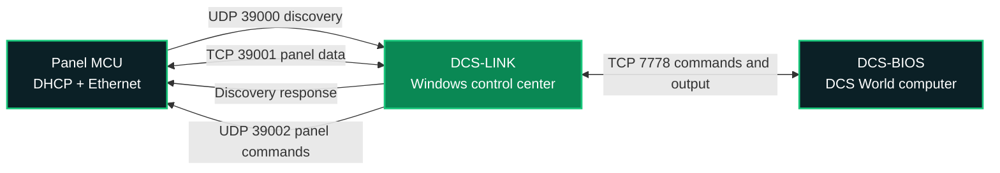

<p align="center">
  
</p>

<h1 align="center">Avionicscraft Simulator Software</h1>

<p align="center">
  <a href="https://avionicscraft.com/"></a>
  
  
  
</p>

<p align="center">
  <strong>One Windows control center for Ethernet-connected flight simulator panels.</strong><br>
  DHCP discovery · Live component monitoring · DCS-BIOS integration · Mission Sync
</p>

<p align="center">
  <a href="#overview">Overview</a> ·
  <a href="#how-it-works">Architecture</a> ·
  <a href="#quick-start">Quick start</a> ·
  <a href="#module-monitoring">Module monitoring</a> ·
  <a href="#network">Network</a> ·
  <a href="#module-protocol">Protocol</a> ·
  <a href="#build-from-source">Build</a> ·
  <a href="#troubleshooting">Troubleshooting</a>
</p>

---

## Overview

Avionicscraft Simulator Software connects Ethernet-based flight simulator panels controlled by a microcontroller (MCU) to [DCS-BIOS](https://github.com/DCS-Skunkworks/dcs-bios). It provides one Windows application for discovering panels, monitoring their live state, forwarding physical controls to DCS and distributing simulator output back to the hardware.

> [!NOTE]
> Panel MCUs obtain an address through DHCP and automatically locate DCS-LINK. Fixed panel IP addresses are not required.

### Main features

| Network and reliability | Monitoring and control | System integration |
|---|---|---|
| Automatic Ethernet discovery | Live aircraft, panel, MAC and IP list | One DCS-BIOS link for all panels |
| DHCP-based addressing | Component, GPIO, label and state details | Mission input synchronization |
| Automatic reconnection | Compatible PWM backlight testing | Optional Windows startup |
| Temporary trusted-MAC allow-list | Configurable activity-log retention | Generic text-based panel protocol |

### Documentation

| Guide | Markdown | Illustrated PDF |
|---|---:|---:|
| Product overview and setup | This README | [Open PDF](output/pdf/Avionicscraft_Simulator_Software_README.pdf) |
| Software and network troubleshooting | [Open guide](TROUBLESHOOTING.md) | [Open PDF](output/pdf/Avionicscraft_Software_Network_Troubleshooting.pdf) |

## How it works



Each MCU broadcasts a discovery request on the local network. DCS-LINK replies with its panel connection port, after which the MCU establishes a persistent TCP connection. Physical inputs travel to DCS-BIOS and simulator output data is sent back to every connected panel.

### Mission input synchronization

DCS may reset cockpit controls while a mission is loading. A physical switch can therefore differ from its virtual cockpit switch even though the hardware has not moved.

DCS-LINK prevents this mismatch by storing the latest numeric value of every known panel input:

- All known input states are sent immediately after DCS-BIOS connects.
- The complete input state is sent again approximately once per second.
- Switches, selectors and potentiometers remain authoritative.
- Indicator lights, LED feedback and other outputs are excluded.

> [!IMPORTANT]
> If a virtual control is changed with the mouse while its physical control remains elsewhere, Mission Sync restores the physical position within approximately one second.

## Requirements

| Windows application | Panel hardware |
|---|---|
| Windows 10 or Windows 11 | Compatible MCU board with Ethernet interface |
| [.NET 6 Desktop Runtime](https://dotnet.microsoft.com/download/dotnet/6.0), or SDK for source builds | Arduino `Ethernet` library |
| DCS World with DCS-BIOS installed | `DCS-BIOS Arduino Library` |
| Private LAN allowing local UDP broadcasts | A unique MAC address for every MCU |

## Quick start

| Step | Action |
|---:|---|
| **1** | Install and configure DCS-BIOS on the DCS computer. |
| **2** | Start `AvionicscraftSimulatorSoftware.exe`. |
| **3** | Enter `127.0.0.1` when DCS-LINK runs on the DCS computer, or enter that computer's LAN address when it runs elsewhere. |
| **4** | Keep TCP port `7778` unless the DCS-BIOS server uses another port. |
| **5** | Keep **DCS-BIOS** selected as the output mode and click **Start**. |
| **6** | Power the panel MCUs. They should appear automatically under **Connected Modules**. |

### DCS-BIOS status indicator

| Indicator | State | Meaning |
|:---:|---|---|
| 🟢 | **Connected** | The TCP connection to DCS-BIOS is active. |
| 🟠 | **Connecting** | DCS-LINK is running and retrying the connection. |
| 🔴 | **Stopped** | Click **Start** to enable DCS-LINK. |

> [!TIP]
> The DCS-BIOS connection and panel connections are independent. A panel can appear under **Connected Modules** while the DCS-BIOS indicator is orange.

### Output modes

- **DCS-BIOS** is the available output mode.
- **Virtual joystick (Coming Soon!)** is visible but disabled and cannot be selected or started.

## Module monitoring

Double-click a connected panel, or right-click it and select **View module status**.

| Field | Information shown |
|---|---|
| Component | Control or output name |
| I/O | Input or output type |
| GPIO | MCU connection |
| Label | Hardware label number |
| Current state | Switch, selector or potentiometer value |
| Brightness | Percentage where applicable |
| Updated | Time of the latest telemetry update |

Three-position controls are displayed as **UP position**, **MID position** and **DOWN position**. Supplied firmware normally sends a complete state snapshot every 100 ms.

### LED output testing

Compatible firmware can use **Push to test LED strip**. Hold the button to request 100% brightness and release it to restore the DCS-controlled value.

> [!WARNING]
> Never power an LED strip directly from an MCU GPIO. Use a suitable transistor or MOSFET driver, a correctly sized power supply and a common ground.

### Panel firmware

- Verify GPIO assignments before uploading firmware.
- Assign a unique MAC address to every MCU.
- Duplicate MAC addresses cause unreliable discovery and reconnection.
- The generic protocol supports different aircraft and control layouts without panel-specific Windows UI code.

> [!CAUTION]
> **Add trusted MAC** creates a temporary in-memory allow-list for the current DCS-LINK session. After one MAC is added, other MCUs must also be added. Clicking **Stop**, followed by **Start**, clears this temporary list.

## Network

| Port | Protocol | Direction | Purpose |
|---:|:---:|---|---|
| `7778` | TCP | DCS-LINK → DCS-BIOS | Commands and simulator output |
| `39000` | UDP | MCU → DCS-LINK | Automatic panel discovery |
| `39001` | TCP | MCU → DCS-LINK | Persistent panel data connection |
| `39002` | UDP | DCS-LINK → MCU | Panel commands such as LED testing |

> [!IMPORTANT]
> Panel MCUs and DCS-LINK normally need the same LAN or VLAN because discovery broadcasts do not cross routers. Allow the application on Windows **Private networks**, including inbound UDP `39000` and TCP `39001`.

Only one active copy of Avionicscraft Simulator Software can own the DCS-LINK ports at a time.

## Module protocol

The text protocol is intentionally simple so additional panel firmware can be developed independently.

<details open>
<summary><strong>Discovery and identity</strong></summary>

```text
DCS_PANEL_DISCOVER|MAC_ADDRESS|PANEL_NAME
DCS_PANEL_HUB|39001
DCS_PANEL_HELLO|MAC_ADDRESS|AIRCRAFT|MODULE
```

</details>

<details open>
<summary><strong>DCS-BIOS input command</strong></summary>

```text
CONTROL_IDENTIFIER VALUE
```

Example:

```text
CONTROL_NAME 2
```

</details>

<details open>
<summary><strong>Live component state</strong></summary>

```text
PANEL_STATE|COMPONENT_ID|VALUE|DISPLAY_NAME|IO_TYPE|GPIO|LABEL_NUMBER
```

Display name, I/O type, GPIO and label metadata allow the application to build the module status window without hard-coded panel layouts.

</details>

## Build from source

From the repository root:

```powershell
dotnet run --project .\DcsPanelHub\DcsPanelHub.csproj
```

Create a framework-dependent Release build:

```powershell
dotnet build .\DcsPanelHub\DcsPanelHub.csproj -c Release
```

Create a self-contained Windows x64 release:

```powershell
dotnet publish .\DcsPanelHub\DcsPanelHub.csproj -c Release -r win-x64 --self-contained true
```

Application settings are stored in:

```text
%LOCALAPPDATA%\AvionicscraftSimulatorSoftware\settings.json
```

## Windows startup

Click **Enable Windows startup** to launch the application after the current user signs in and automatically start DCS-LINK. The button changes to **Disable Windows startup** while the option is enabled.

Re-enable Windows startup after moving or renaming the executable so the registered path remains correct.


<p align="center">
  <sub>This documentation intentionally uses generic MCU and panel terminology so the same architecture can support different aircraft and control layouts.</sub>
</p>
